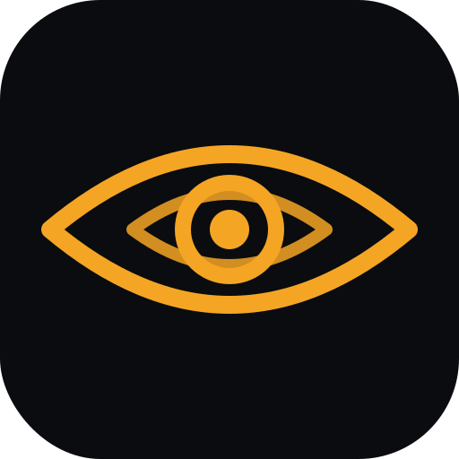

# Thirdeye brand assets

Official visual identity for **Thirdeye AI** — the crypto-native LLM gateway.

## Palette

| Name | Hex | Use |
| --- | --- | --- |
| Ink | `#0A0C10` | Primary background |
| Signal amber | `#F5A524` | The only accent |
| Paper | `#FEFEFE` | Light mode, print |

One accent, always. Never introduce a second hue, gradient, or outline.

## The mark

A lens containing a second lens, with a three-ring pupil: the "third eye" without
literal triangles. Flat geometry, uniform stroke, legible at 32 px next to a ticker.

`svg/` holds the masters and is the source of truth:

- `thirdeye-mark.svg` — transparent, amber strokes on nothing
- `thirdeye-mark-dark.svg` — ink tile with rounded corners, for app and social icons
- `thirdeye-mark-mono.svg` — single ink colour, for print and light surfaces

Recolour by editing the stroke value. Do not redraw the geometry.

## What goes where

| Destination | File | Spec |
| --- | --- | --- |
| Token avatar (DEX, explorers, wallets) | `tokens/token-avatar-512.png` | 512×512, opaque, no text |
| X / Twitter profile | `social/x-profile-400.png` | 400×400 |
| Telegram group photo | `social/telegram-512.png` | 512×512 |
| Discord server icon | `social/discord-512.png` | 512×512 |
| Slack and integrations | `social/slack-512.png` | 512×512, transparent |
| Favicon | `png/vector-mark-transparent-32.png` | 32×32 |
| Docs and headers | `social/banner-header.png` | 1600 wide |
| Print, invoices, one-pagers | `print/mono-1024.png` | 1024×1024 mono |

`png/` also carries every master rendered at 1024 → 32 px for tools that reject SVG.

## Rules

1. Clear space around the mark equals the height of the pupil ring.
2. Ink or paper backgrounds only. Never amber on amber, mid-grey, or photography.
3. Below 48 px use `vector-mark-transparent` or the mono master; illustrative renders lose detail.
4. Never stretch, rotate, outline, or add shadow. The mark is always flat.
5. The token avatar never carries text; platforms render the ticker beside it.
6. Illustrative renders (AI-produced variants) are for campaigns only, never for the token avatar or favicon.

## Note on the amber tile on black

Identity tiles are drawn on `#0A0C10`. If a venue crops the avatar to a circle you
will see small black corners; this is expected and invisible on dark interfaces.
For light-background venues use `png/vector-mark-mono-512.png` instead.

## Licence

Internal brand asset. All rights reserved by Thirdeye AI.
